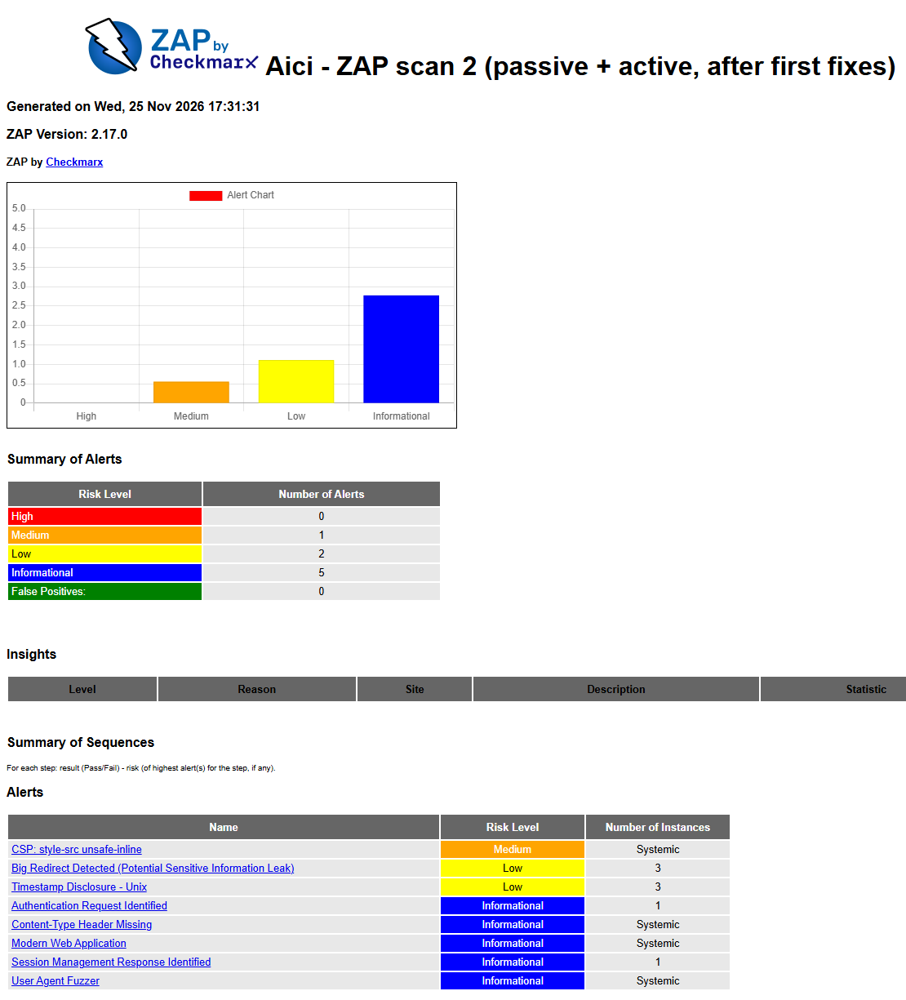
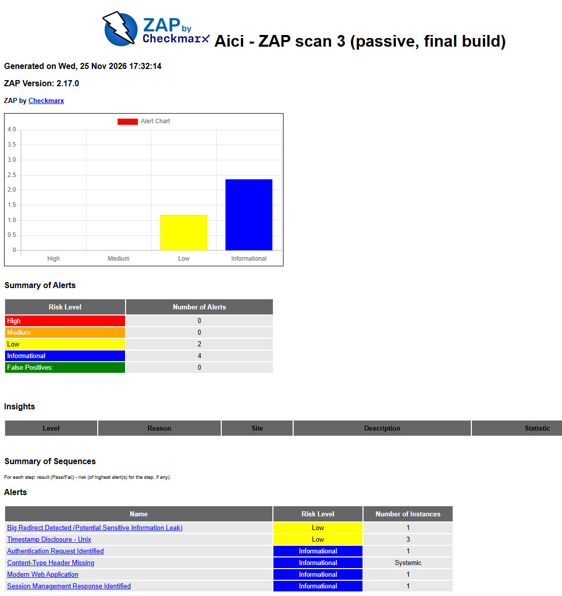
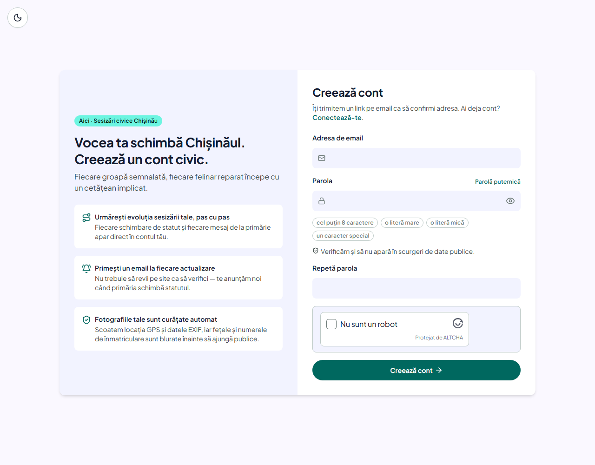

# Task 3. Scanning Aici with OWASP ZAP

**Group FAF-242:**

1. Bulimar Rodion
2. Moroșanu Ion
3. Eftode Andrei
4. Țurcanu Nicolae
5. Cătănoi Sergiu

OWASP ZAP 2.17.0 run against Aici, passive and authenticated active, the vulnerabilities found,
the fixes, and the rescan that confirms them. Scanned on 24 November 2026, on branch
`fix/zap-scan-findings` (from `main` at `682ea81`).

## 1. OWASP ZAP in short

OWASP ZAP (Zed Attack Proxy) is an open source web vulnerability scanner. It sits as a proxy
between the browser and the application, records every request and response, and raises
problems as alerts with a risk level (High, Medium, Low, Informational) and a confidence. The
spider finds pages by following links; the AJAX spider drives a real browser, which a React app
like Aici needs, because most of its links only exist after JavaScript runs.

| Mode | How it works | What it finds | Risk to the app |
| --- | --- | --- | --- |
| Passive scan | Reads the traffic that already goes through the proxy, sends nothing of its own | Missing security headers, cookies without flags, information leaked in headers and bodies | None, it only reads |
| Active scan | Replays the requests it has seen with attack payloads in every parameter | Exploitable flaws: XSS, SQL injection, path traversal, command injection, template injection | Creates and changes data, so it is only run against a copy we own |

## 2. Setting up the environment

| Part | What we used |
| --- | --- |
| App | Production build (`npm run build`, `npm start`) on `http://localhost:3000`, Windows 10 |
| Database | A separate local PostgreSQL 17 with PostGIS 3.7, created from `db/init.sql` and `db/migrate.ts`, with fresh secrets. Not the shared Neon project, so the active scan's junk never reached real data. |
| ZAP | 2.17.0 (Java 21 runtime), daemon mode, proxy on `127.0.0.1:8090`, driven through its REST API |
| Live site | `https://aici-seven.vercel.app`, **passive only** |

Steps:

1. Download ZAP 2.17.0 (cross platform package) from zaproxy.org and a Java 21 runtime.
2. Start the app against the local database: `npm run build`, then `npm start`.
3. Start ZAP as a proxy: `java -jar zap-2.17.0.jar -daemon -host 127.0.0.1 -port 8090 -config api.key=…`.
   We drove it through the API from a script (`scan2.sh`), so every run is repeatable with the
   same settings. In a browser the same is done with *Settings → Network → Manual proxy* plus
   ZAP's CA certificate.
4. Send the traffic through the proxy: every page and API by hand, 3 reports with a photo, a
   staff login, then the spider and the AJAX spider (headless Chrome, 1,724 requests).
5. Check the proxy sees everything: the requests appear in ZAP's history
   (`core/view/numberOfMessages` → 8,671 for the first run).

## 3. Passive scan

ZAP collected 8,671 requests and responses locally and raised 8 kinds of alerts, 1 of them
Medium. The live site, with 16 GET requests to the public pages (no forms, no spider), showed
the same problems.

| Passive alert (ZAP id) | CWE | Risk | Local (URLs) | Live site (URLs) |
| --- | --- | --- | --- | --- |
| Content Security Policy (CSP) Header Not Set (10038) | 693 | Medium | 28 | 11 |
| Server Leaks Information via `X-Powered-By` (10037) | 497 | Low | 29 | 12 |
| Big Redirect Detected (10044) | 201 | Low | 3 | 1 |
| Timestamp Disclosure, Unix (10096) | 497 | Low | 2 | 1 |
| Content-Type Header Missing (10019) | 345 | Info | 7 | – |
| Retrieved from Cache, Cache-control (10050, 10015) | 525 | Info | – | 15 |
| Modern Web Application (10109) | – | Info | 3 | 1 |
| Authentication Request / Session Management Response Identified (10111, 10112) | – | Info | 2 | – |

## 4. Authenticated active scan

**Authenticated.** A test admin account logged in, and ZAP's *Replacer* rule put its session
cookie on every request to `localhost:3000`, so the staff pages and APIs were attacked too, not
only the public ones. Left out of the scan, so it couldn't sign itself out or lock its own
account: logout, account deletion, staff deactivation, password change.

**Scanned twice.** In the first run the app's own rate limits refused most of the attack
requests: the report form allows 20 submissions per IP per hour, the login asks for an ALTCHA
after 20 failures, and the duplicate check allows 60 lookups. So "nothing found" there partly
meant "the attacks never reached the code". For the second run we raised those limits in the
local build only (never committed), so the payloads really reached the input handling: 445
login attempts and 419 duplicate check lookups went through. The limits were put back afterwards.

The two runs sent 12,703 attack requests through 51 rules, about 6 minutes each. The counts come
from ZAP's log (`completed host/plugin … with N message(s) sent`):

| Attack (ZAP rules) | Run 1 requests | Run 2 requests | Alerts |
| --- | --- | --- | --- |
| SQL injection (generic, and time based for PostgreSQL, MySQL, MSSQL, Oracle, HSQLDB) | 1,364 | 1,178 | 0 |
| OS command injection (and time based) | 770 | 665 | 0 |
| Server side template injection (and blind) | 572 | 494 | 0 |
| Known RCE (Spring4Shell, CVE-2012-1823, React2Shell, Shellshock) | 443 | 465 | 0 |
| Path traversal | 366 | 312 | 0 |
| Cross-site scripting (reflected and persistent) | 235 | 224 | 0 |
| XSLT and XPath injection | 226 | 197 | 0 |
| Remote file inclusion | 220 | 190 | 0 |
| External redirect | 198 | 171 | 0 |
| Server side code injection | 176 | 152 | 0 |
| Server side include, format string, buffer overflow | 176 | 152 | 0 |
| CRLF injection | 154 | 133 | 0 |
| Parameter tampering | 119 | 122 | 0 |
| Other: hidden files, `.env`, `.htaccess`, `WEB-INF`, directory listing, cloud metadata | 379 | 390 | 0 |
| User agent fuzzer | 1,188 | 1,272 | 337 + 517 Info |
| Cross-site scripting (DOM based) | skipped | skipped | – |
| **Total** | **6,586** | **6,117** | **0 above Info** |

**No injection was found.** No 500 and no stack trace came back in either run, and the server
logged no error. The user agent fuzzer alerts only note that a page looks the same for every
browser.

**What ZAP did not cover.** The DOM XSS rule needs Firefox, which wasn't installed, so ZAP skipped
it (`DomXssScanRule - Skipping scanner, failed to start browser`). React escapes everything it
renders and the app has no `dangerouslySetInnerHTML` on user data, and the CSP added below now
blocks any script without the nonce, but this rule should be run next time. ZAP also sent only
26 requests to the report form, because it barely fuzzes multipart forms that carry a file, so
we tested that form by hand through the proxy:

| Manual test | Result |
| --- | --- |
| SQL injection in the description (`x'); drop table reports; --`) | Saved as text, the table untouched. All queries are parameterized. |
| SQL injection and odd values in category, lat, lng (`' or '1'='1`, `NaN`, `1e309`, `pg_sleep(5)`) | 400 from the zod schema, no delay |
| Stored XSS in the description (`<script>`, ``, `<svg onload>`) | Shown escaped to staff on the dashboard (`&lt;script&gt;`) and as plain text in the JSON |
| A text file or an SVG sent as the photo | 400, refused before processing |
| Staff pages and APIs without a session | Pages and the report list: 307 to the login. Changing a status, exporting citizen data: 401. A photo of an unknown report: 404. |
| A report sent with `Origin: https://evil.example` | **201, accepted.** This became V5. |

## 5. Vulnerabilities found

No High risk. Two Medium and three Low problems, all of configuration or a missing check, none
in the input handling. V2 was found by the rescan, in our own first fix for V1. V5 was found by
the manual test.

| # | Type (ZAP alert, CWE) | Location | Possible impact | Cause |
| --- | --- | --- | --- | --- |
| V1 | CSP Header Not Set (10038), CWE-693, **Medium** | Every page: 28 local, 11 live | Any XSS that got into a page would run with nothing to stop it. The CSP is the second line of defence behind React's escaping (planned in SR-07). | Headers came from `next.config.mjs`, which is static, and a strict CSP needs a new nonce per response |
| V2 | CSP: style-src unsafe-inline (10055), CWE-693, **Medium** | Every page: 140 alerts on 28 URLs | An injected `<style>` tag can read a page with CSS attribute selectors (a token in an attribute, say) and send it out through background image URLs | The ALTCHA widget added its own `<style>` tag at runtime, so our first policy had to allow inline styles |
| V3 | `X-Powered-By: Next.js` (10037), CWE-497, Low | Every response: 29 local, 12 live | The attacker learns the framework at no cost and can look up its advisories | Next.js sends the header by default |
| V4 | Big Redirect Detected (10044), CWE-201, Low | `/reports` (staff), `/profile` (citizen) without a session: a 307 with an 18 KB body | None in practice: the bodies held only the page shell and Next's redirect marker, no report, no account data. But the page was rendered for a visitor who had no right to it. | Both pages were missing from the list `src/proxy.ts` checks, unlike `/dashboard` |
| V5 | Cross-site request forgery (manual test), CWE-352, Low | `POST /api/reports` | A foreign page can make every visitor's browser file anonymous reports, each from its own IP, which gets around the 20 per IP per hour limit and floods the city hall's list. Not in a signed-in citizen's name: that cookie is `SameSite=Lax`. | The only route that changes data without the `sameOrigin()` check |

## 6. Fixes and rescan

| # | Fix | How it was verified |
| --- | --- | --- |
| V1 | `src/proxy.ts` builds the policy for every response with a new 128 bit nonce (`src/server/security/csp.ts`). Next.js reads the nonce from the request and puts it on its own scripts, `src/app/layout.tsx` puts it on the theme script. | Alert 10038 gone. 0 CSP violations in headless Chrome on every page (below). |
| V2 | ALTCHA loads from its external build `altcha/external`, its CSS as a file and its worker from our own origin (`src/app/altcha/[file]/route.ts`, one file name allowed). Policy is now `style-src 'self' 'nonce-…'`; only `style-src-attr 'unsafe-inline'` stays, for React's `style={{}}` attributes, which hold declarations for one element and no selectors. | Alert 10055 gone. ALTCHA still solves its proof of work and reaches `verified`. |
| V3 | `poweredByHeader: false` in `next.config.mjs` | Alert 10037 gone |
| V4 | `src/proxy.ts` redirects `/reports` to `/login` without a staff cookie and `/profile` to `/sign-in` without a citizen cookie, before anything renders. The real check still runs in the page against the database. | Only the `/login` big redirect is left, a false positive (section 7) |
| V5 | `POST /api/reports` checks `sameOrigin()` first and answers 403, like every other route that changes data | A foreign `Origin` or none: 403. The app's own form: 201. |

The policy built in `src/server/security/csp.ts` (V1, V2):

```ts
export function buildCsp(nonce: string, dev = process.env.NODE_ENV !== "production") {
  const directives: Record<string, string[]> = {
    "default-src": ["'self'"],
    "script-src": ["'self'", `'nonce-${nonce}'`, "'strict-dynamic'", ...(dev ? ["'unsafe-eval'"] : [])],
    "style-src": ["'self'", `'nonce-${nonce}'`],
    "style-src-elem": ["'self'", `'nonce-${nonce}'`],
    "style-src-attr": ["'unsafe-inline'"],
    "img-src": ["'self'", "data:", "blob:", MAP_ORIGIN],
    "connect-src": ["'self'", MAP_ORIGIN],
    "worker-src": ["'self'"],
    "object-src": ["'none'"],
    "base-uri": ["'self'"],
    "form-action": ["'self'"],
    "frame-ancestors": ["'none'"],
  };
  // ...joined into one header value
}
```

Applied per request in `src/proxy.ts`, together with the redirects for V4:

```ts
if (isStaffOnly(pathname) && !req.cookies.has(SESSION_COOKIE)) {
  return NextResponse.redirect(new URL("/login", req.url));   // V4, before any render
}
if (isCitizenOnly(pathname) && !req.cookies.has(CITIZEN_COOKIE)) {
  return NextResponse.redirect(new URL("/sign-in", req.url)); // V4
}
const nonce = newNonce();                                     // V1, 128 random bits
const csp = buildCsp(nonce);
const headers = new Headers(req.headers);
headers.set("x-nonce", nonce);
headers.set("Content-Security-Policy", csp);                  // Next.js reads the nonce here
const res = NextResponse.next({ request: { headers } });
res.headers.set("Content-Security-Policy", csp);              // and the browser gets it here
```

`next.config.mjs` (V3) and `src/app/api/reports/route.ts` (V5):

```ts
const nextConfig = { poweredByHeader: false, /* ... */ };

async function handlePost(req: NextRequest) {
  if (!sameOrigin(req)) return fail(403, "Cerere respinsă.");
  // ...
}
```

### Before and after

| Run | Requests | High | Medium | Low | Info |
| --- | --- | --- | --- | --- | --- |
| 1. Local, before the fixes, passive and active | 8,671 | 0 | 28 | 36 | 350 |
| Live site, passive | 16 | 0 | 11 | 14 | 16 |
| 2. Local, first fixes, rate limits raised, passive and active | 8,024 | 0 | 140 | 6 | 528 |
| 3. Local, final build, passive | 1,693 | 0 | **0** | 4 | 11 |

| Alert | Run 1 | Run 2 | Run 3 (final) |
| --- | --- | --- | --- |
| Medium: CSP Header Not Set | 28 | 0 | 0 |
| Medium: CSP style-src unsafe-inline | – | 140 | 0 |
| Low: `X-Powered-By` | 29 | 0 | 0 |
| Low: Big Redirect | 3 | 3 | 1 (false positive) |
| Low: Timestamp Disclosure | 4 | 3 | 3 (false positive) |

The counts are alert instances, from ZAP's `core/view/alerts` after each run. Run 2's Medium went
up because ZAP raises 10055 once per directive that allows inline styles (5 per page), not
because the app got worse.



*Figure 1. ZAP's own report for run 2: the only Medium is CSP style-src unsafe-inline (V2), found
in our first CSP.*



*Figure 2. ZAP's report for the final build: 0 High, 0 Medium, the 2 Low types are the false
positives in section 7.*



*Figure 3. The sign up page under the final policy. The ALTCHA widget loads its CSS from a file
and looks as it does on the live site.*

ZAP's full HTML reports, with every alert, URL and evidence (session cookie and test password
redacted), are in `docs/security/zap-reports/`: `zap-scan2-active-after-first-fixes.html` and
`zap-scan3-passive-final.html`. Run 1 was scanned in an unsaved session, so its alerts are kept as
the JSON ZAP returned, summarised in the tables above.

Other checks:

- In headless Chrome, under the new policy: home, map, sign up, sign in, staff login, privacy and
  password pages load with **0 CSP violations**. The map draws, ALTCHA reaches `verified`, the
  theme script sets dark mode before the first paint, and the photo path (canvas, `toBlob`, a
  `blob:` preview) works.
- `tests/security/csp.test.ts`: scripts need the nonce, no eval in production, inline styles only
  as attributes, no framing, no plugins, a new nonce every time. All 71 tests pass, the type
  check and lint are clean.

## 7. False positives

| Alert | Why it is not a problem |
| --- | --- |
| Timestamp Disclosure (10096) | The expiry time inside the ALTCHA challenge, which is meant to be public, and a constant inside MapLibre's code |
| Big Redirect on `/login` (10044) | A signed-in staff member sent on to `/dashboard`. The body is the login page shell, nothing private. |
| Content-Type Header Missing (10019) | The empty bodies of 307 and 308 redirects |
| Authentication / Session Management Identified (10111, 10112) | ZAP noting where the login and the session cookie are |
| User Agent Fuzzer (10104) | The page looks the same for every browser |

## 8. What is left

- The live site still has V1 to V5 until the branch is merged and deployed. After that, a passive
  scan of the beta should show no CSP or `X-Powered-By` alert.
- The DOM XSS rule was skipped. The next run needs Firefox (or ZAP's Chrome option) installed.
- ZAP can't fill the report form with a real photo on its own. A scan script that sends a valid
  image with each payload would let it fuzz that route as deeply as the others.
- `npm audit` reports 9 advisories (7 moderate, 2 high) in dependencies. That is outside what ZAP
  looks at and is covered by SR-08 and Dependabot.

## 9. Conclusions and what we learned

Aici withstood 12,703 automated attack requests (SQL injection, XSS, command and template
injection, path traversal) and the manual tests. The five problems found were configuration and
one missing check, not flaws in how input is handled, and all five were fixed and rescanned in
the same cycle.

- **The authenticated scan matters.** Without the staff cookie ZAP would only have seen the
  public pages, not the dashboard, the status changes or the export.
- **Our own defences got in the way.** Without raising the rate limits for a test build, "nothing
  found" would have meant "nothing tested" on the routes that matter most.
- **An automated scan finds what is missing better than logic holes.** The one real access gap,
  V5, came from testing the form by hand.
- **A fix can bring its own finding.** Our first CSP allowed inline styles and only the rescan
  showed it. That is why the rescan is part of the fix.
- **ZAP doesn't cover everything.** DOM XSS was skipped and the file upload form was barely fuzzed.
  Knowing what wasn't tested is part of the result.
- **Continuous testing.** Next step: `zap-baseline` (passive) on every push and `zap-full-scan`
  (active) weekly in CI, so a regression like `'unsafe-inline'` is caught before it reaches
  production.

## 10. Team contributions

| Member | What they did |
| --- | --- |
| Bulimar Rodion | [to fill in] |
| Moroșanu Ion | [to fill in] |
| Eftode Andrei | [to fill in] |
| Țurcanu Nicolae | [to fill in] |
| Cătănoi Sergiu | [to fill in] |
